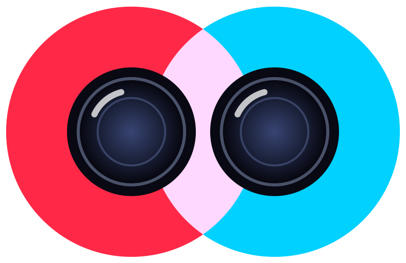

<p align="center"></p>

# StereoVision

StereoVision turns the two rear cameras of an iPhone (wide + ultra-wide) into a real-time **stereo camera**. It measures how far things are, recognizes and outlines objects (80 everyday classes: people, chairs, bottles, laptops…), and shows the scene in 9 different ways, from a classic depth map to a navigable 3D point cloud.

> **Tested only on iPhone 16.** Other iPhones with wide + ultra-wide rear cameras should work, but camera formats, calibration and performance may differ. The LiDAR source has never been run on a real device.

This is a personal study project, not tied to any course assignment or exam. I built it to get a hands-on understanding of concepts covered in my Artificial Vision lectures: epipolar geometry, rectification, stereo matching, triangulation and object detection. Seeing them run live on a phone made them much easier to grasp.

The full stereo pipeline (rectification, matching, triangulation) is written from scratch and runs on the GPU. You can switch to Apple's own depth, or to the LiDAR scanner on Pro models, at any time to compare them.

## What it does

- **Live depth** at roughly 20+ fps on iPhone 16
- **Object detection and segmentation** with YOLO11n-seg: each object gets a label, a confidence score, a colored mask and an ID that follows it from frame to frame
- **Metric measurements** for every object: distance, lateral offset and approximate width × height in cm
- **Tap to measure** any point; the crosshair always shows the distance at the center
- **Three depth sources**: the custom stereo matcher (default), Apple's Dual-Wide depth, and LiDAR on iPhone Pro models (12 Pro and later). The LiDAR option only appears on phones that have the sensor. It measures distance directly with laser time-of-flight, so it works on textureless walls where stereo fails and reaches about 5 m. That makes it a good ground truth for evaluating the stereo matcher
- **Photo and video capture** of exactly what's on screen (current view mode with masks, labels and distances), saved to Photos. Videos are HEVC 1280 px at 30 fps
- **Raw data export** with every photo, for offline analysis (Python, OpenCV, MeshLab…), in *Files › On My iPhone › StereoVision*:

  | File | Content |
  |---|---|
  | `view.png` | the composited view, as saved to Photos |
  | `rgb.png` | the color image the depth refers to |
  | `depth_mm.png` | 16-bit grayscale depth in millimeters (0 = invalid) |
  | `cloud.ply` | colored point cloud in meters (x right, y down, z forward) |
  | `meta.json` | intrinsics, baseline, depth source and settings, detected objects with distance and size |
- **Automatic calibration** of the camera alignment at startup, with manual fine-tuning in Settings

## View modes

| Mode | What you see |
|---|---|
| **Standard** | Camera image with object masks, boxes, labels, distance and size |
| **Depth map** | Distance as color: red is near, blue is far |
| **Overlay** | Camera image and depth map blended together (adjustable opacity) |
| **Disparity** | Grayscale image of the raw stereo signal (brighter = closer) |
| **Rectified pair** | The two camera views side by side with green alignment lines: a matching point must lie on the same line in both images |
| **Anaglyph** | Red/cyan 3D image, for 3D glasses |
| **3D segmentation** | The scene split into surfaces and objects by depth alone, without knowing what they are |
| **Bird's-eye** | Top-down map: field of view, range rings, obstacle profile and detected objects placed on the floor plan |
| **Point cloud** | The scene rebuilt in 3D: drag to rotate, pinch to zoom, tap to reset |

## How depth is measured

The two cameras see the scene from slightly different positions. A nearby object shifts more between the two images than a distant one. That shift is the **disparity** $d$, in pixels. Once the images are aligned (*rectified*), distance follows from triangulation:

$$Z = \frac{f \cdot B}{d}$$

- $Z$: distance from the camera (m)
- $f$: focal length (px), about 470 px at the 640 × 360 working resolution
- $B$: baseline, the distance between the two lenses, about 1 cm on iPhone 16
- $d$: disparity (px)

To find $d$ for every pixel the app uses **Semi-Global Matching (SGM)**. Each pixel is compared with candidate matches in the other image. The algorithm then favors smooth surfaces and penalizes jumps, using two penalties: $P_1$ for 1-pixel steps and $P_2$ for real depth edges. A **left-right consistency check** then throws away pixels where the two views disagree, typically occluded areas or wrong matches. An object's lateral position and size then follow from the pinhole camera model:

$$X = \frac{(u - c_x)\,Z}{f} \qquad W_{\text{object}} = \frac{w_{\text{px}}\,Z}{f}$$

## Limits

The main limit is physical: **the baseline is tiny** (≈ 1 cm, versus ≈ 6.5 cm between human eyes). The figures below use $f \cdot B \approx 4.7\ \text{px}\cdot\text{m}$; the app's HUD shows the real $B$ and $f$ of your device.

**Depth error grows with the square of the distance.** Differentiating $Z = fB/d$:

$$\Delta Z \approx \frac{Z^2}{f \cdot B}\,\Delta d$$

With sub-pixel accuracy $\Delta d \approx 0.2$ px:

| Distance | Expected depth error |
|---|---|
| 0.5 m | ± 1 cm |
| 1 m | ± 4 cm |
| 2 m | ± 17 cm |
| 3 m | ± 38 cm |

**Maximum useful range.** At $d = 1$ px, $Z = fB \approx 4.7$ m. Beyond 2–3 m the measurement is mostly noise. That's physics, not a bug.

**Minimum distance.** It is set by the largest disparity searched, $Z_{min} = fB / d_{max}$:

| Max disparity | Closest measurable point |
|---|---|
| 32 px | ≈ 15 cm |
| 64 px (default) | ≈ 7 cm |
| 96 px | ≈ 5 cm |

In practice the *Min* depth range in Settings (default 12 cm) also clips anything closer, and cameras can't focus that close anyway.

**Lateral resolution.** One pixel covers $Z/f$ meters, about 2 mm at 1 m and 4 mm at 2 m. Object sizes inherit the depth error: a 10% error on $Z$ gives a 10% error on width and height.

**Scenes that fool stereo vision:**

- **Textureless surfaces** (white walls, uniform tables): there is nothing to match. SGM fills in part of them from the edges, and the rest stays black (invalid)
- **Reflective or transparent objects** (mirrors, glass, screens): the matched point is the reflection, not the surface
- **Repetitive patterns** (grids, tiles, blinds): several candidate matches look equally good
- **Occlusion borders**: a strip next to foreground objects is visible to only one camera. The left-right check marks it invalid
- **Thin structures** (cables, chair legs) can be smoothed away
- **Low light and fast motion**: sensor noise and motion blur reduce the number of valid pixels
- **Image quality gap**: the ultra-wide is upsampled about 2× to match the wide, so it is blurrier, which limits fine detail
- **Calibration drift**: if depth looks wrong, open *Rectified pair*, check that features sit on the same green line, and press *Calibrate*

Detection runs asynchronously, so masks can trail slightly behind fast-moving objects.

## Performance and accuracy

**Speed (iPhone 16, SGM + left-right check + YOLO11n-seg):** about 20–22 fps, stable. The camera caps at 30 fps. To trade accuracy for speed, reduce the maximum disparity to 32 or switch to block matching in Settings.

**Matching accuracy on a synthetic scene with known disparity** (`swift scripts/verify_stereo.swift`, runs the app's GPU code on a Mac). The scene has a slanted plane, a foreground object and a band with almost no texture (4% contrast):

| Algorithm | Correct (±1 px) | Wrong | Invalid |
|---|---|---|---|
| Block matching 5×5 | 62.2% | 6.5% | 31.2% |
| SGM, 4 paths | 75.2% | 13.9% | 10.8% |
| SGM + left-right check | 72.4% | 9.3% | 18.3% |

- SGM recovers far more of the low-texture area than block matching: invalid pixels drop from 31% to 11%
- The left-right check cuts wrong matches by about a third, at the cost of marking some extra pixels invalid
- Numbers vary slightly between runs because the test texture is random

**Distance of detected objects** is the median depth over the inner part of the object's mask, so background pixels inside the bounding box do not bias it. The value is also smoothed over time per tracked object.

## Getting started

Requirements: an iPhone with a Dual-Wide camera and iOS 18+, Xcode 26+ with the Metal Toolchain (`xcodebuild -downloadComponent MetalToolchain`), and [uv](https://github.com/astral-sh/uv) to export the YOLO model.

```sh
git clone <repo> && cd stereo-camera-iphone
cp Config/Local.xcconfig.example Config/Local.xcconfig   # set your Apple team ID and a unique bundle id
scripts/export_yolo.sh                                   # downloads and converts YOLO11n-seg
open StereoVision.xcodeproj                              # Run on your iPhone
```

Without the YOLO model the app still works and falls back to Apple's built-in detectors (people, animals, salient objects). Hold the phone in **landscape**, with the Dynamic Island on the left.
